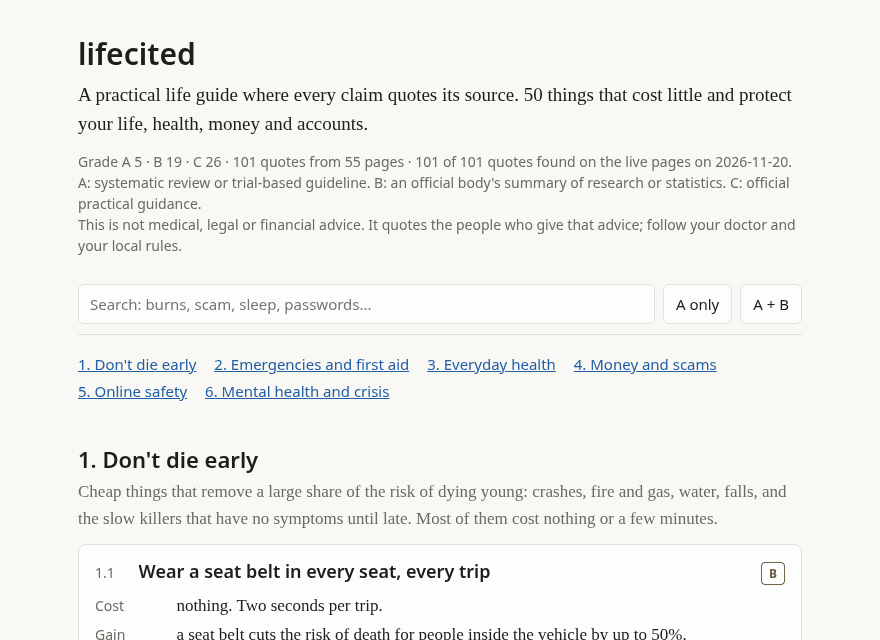

# lifecited

A practical life guide in plain English where every claim quotes its source, and a bot checks every week that the quote is still on the source's page.

**[Read it online](https://tahakocp.github.io/lifecited/)** (one 74 KB page, works offline once saved) · [Chapters in Markdown](book/)

<p align="center"></p>

50 cheap things that protect your life, health, money and accounts: wear the seat belt in the back too, cool a burn under running water for 20 minutes, never more than 8 paracetamol tablets in 24 hours, hang up when an "investment" has to be decided today. Each entry says what it costs, what it buys you, how strong the evidence is, and quotes the WHO, NHS, CDC, a Cochrane review or a regulator word for word.

| | |
|---|---|
| Entries | 50 (grade A 5, B 19, C 26) |
| Quotes | 101, from 55 pages (WHO, NHS, CDC, USPSTF, CISA, NCSC, FCA, CFPB, FINRA, Cochrane abstracts) |
| Quotes found on the live pages | 101 of 101 from my machine on 2026-11-20. From GitHub's runners 98 of 101: reportfraud.police.uk answers them with 403, so its 3 quotes show as unreachable |
| Mutation test | changed one digit in each of the 48 quotes that contain a number; the checker flagged 48 of 48 |
| Full check | about 10 s for all 55 pages, 4 requests at a time |

## Chapters

| chapter | entries | A | B | C |
|---|---|---|---|---|
| [1. Don't die early](book/01-dont-die-early.md) | 15 | 4 | 10 | 1 |
| [2. Emergencies and first aid](book/02-emergencies.md) | 11 | 0 | 0 | 11 |
| [3. Everyday health](book/03-everyday-health.md) | 10 | 1 | 7 | 2 |
| [4. Money and scams](book/04-money-and-scams.md) | 6 | 0 | 0 | 6 |
| [5. Online safety](book/05-online-safety.md) | 5 | 0 | 0 | 5 |
| [6. Mental health and crisis](book/06-mental-health.md) | 3 | 0 | 2 | 1 |

## What an entry looks like

```markdown
### 6. Burns: cool running water for 20 minutes
- Cost: twenty minutes at the tap.
- Gain: cool running water for 20 minutes, within 3 hours, is the first treatment for burns and scalds.
- Grade: C
- Source: [NHS, Burns and scalds](https://www.nhs.uk/conditions/burns-and-scalds/)
  > Hold the burn or scald under cool running water for 20 minutes. Do this as soon as possible, within 3 hours of it happening.
- Note: not ice, not butter, not toothpaste.
```

Grades describe the source, not how important the advice is:

- **A**: a systematic review, or a guideline graded on trials (Cochrane, USPSTF).
- **B**: an official body's summary of research, or official statistics (WHO fact sheets, CDC data).
- **C**: official practical guidance (first aid, security and consumer advice). Most first aid has never been tested in a trial that gives a number. C says that; it does not say the advice is weak.

## How the checking works

`cite` is a small Go program with no dependencies.

- `cite lint` parses the chapters strictly. Every entry needs a cost, a gain, a grade and at least one quoted source, and every number in the Gain line has to appear in one of the entry's quotes. On the first run it found six numbers in four of my own summaries that the quotes did not back, for example "5 to 6 cm" when the page says "five-six centimetres".
- `cite check` downloads each page once and looks for each quote. Matching ignores case, punctuation, curly quotes and spacing, but every word and number has to be there in order. When a quote is missing it prints how much of it still matches, so you can tell a changed number from a deleted page. It also warns when a page redirects elsewhere; in the first runs that flagged six moved pages, including Action Fraud becoming Report Fraud.
- PubMed blocks scripts, so PubMed links are checked against the abstract from the [Europe PMC API](https://europepmc.org/RestfulWebService).
- CI runs the check on every push and every Monday. The [published page](https://tahakocp.github.io/lifecited/) shows "quote found" or "quote not found" under each quote from the latest run.

Run it yourself (Go 1.22+):

```sh
git clone https://github.com/tahakocp/lifecited && cd lifecited
go run ./cmd/cite check -cache .cache   # live quote check
go run ./cmd/cite build -o site         # site/index.html
scripts/mutation-test.sh .cache         # needs jq
```

## Limits

- This is not medical, legal or financial advice. It quotes the people who give that advice. Your doctor and your local rules come first.
- 50 entries is a start, not a book. Chapters 4 to 6 are thin.
- Most sources are from the US and the UK, so emergency numbers and some figures are local to them. The first aid and money chapters say so at the top.
- A quote being on the page proves the source says it, not that the source is right, and not that my one-line summary is fair. The number rule catches invented figures; it can't catch a summary that overstates a careful sentence.
- Some sites block requests from cloud servers. Those show up as "unreachable" warnings, not failures. PDFs and paywalled papers are not supported.
- I wrote this with help from AI tools. Every quote was checked by the tool against the live page, and I reread the summaries against the quotes, but no doctor, lawyer or financial adviser has reviewed it yet. If you are one, a review of a single chapter is the most useful thing you could give this project.

## Why

[HowToLiveBetter](https://github.com/eternity4719/HowToLiveBetter) showed how much people want a guide like this: an evidence-graded life guide in Chinese, built around Chinese law and institutions. There was no English one with a global scope, and none where the citations are machine-checked. This one starts small and keeps every line traceable.

## Contributing

See [CONTRIBUTING.md](CONTRIBUTING.md). Corrections and professional reviews matter most: [report a wrong entry](https://github.com/tahakocp/lifecited/issues/new?template=wrong-quote.yml), [suggest an entry](https://github.com/tahakocp/lifecited/issues/new?template=new-entry.yml).

## License

Guide text in `book/`: [CC BY 4.0](book/LICENSE). Code: [MIT](LICENSE). Quotes belong to their sources and are used for citation.
